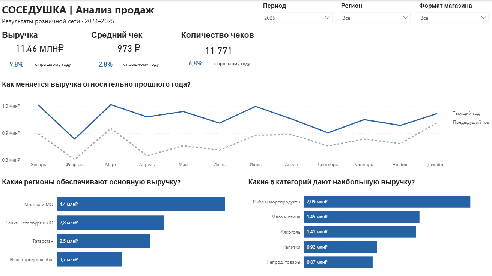

# Анализ продаж розничной сети «Соседушка»

#### Power BI | DAX | Power Query | Коммерческая аналитика

Аналитический проект на учебных транзакционных данных розничной сети за 2024–2025 годы.

## 1. Бизнес-задача

Руководству сети «Соседушка» необходимо оценить динамику продаж, выявить различия в результатах магазинов и определить направления для дальнейшего анализа.

В рамках проекта исследованы следующие вопросы:

* Как изменяется выручка сети и какие показатели сопровождают её рост?
* Какие регионы и магазины показывают лучшие и худшие результаты?
* Насколько эффективно магазины разных форматов используют торговую площадь?
* Как использование карт лояльности связано со средним чеком и скидками?
* Какие месяцы характеризуются снижением продаж?

**Результат:** интерактивный Power BI-отчёт с двумя аналитическими страницами и выводами для бизнеса.

## 2. Ключевые выводы и рекомендации

**Наблюдение 1.** Что обеспечило рост выручки сети?

В 2025 году выручка сети выросла с 10,43 до 11,46 млн ₽ (+9,8%). Количество чеков увеличилось с 11 019 до 11 771 (+6,8%), одновременно вырос средний чек — с 947 до 973 ₽ (+2,8%).

Рост выручки сопровождался увеличением и количества покупок, и средней суммы покупки. При этом рост среднего чека не обязательно связан с повышением цен: он может отражать изменение объёма и состава покупок.

Следует определить, какие регионы, товарные категории и магазины внесли наибольший вклад в абсолютный прирост выручки, а также сравнить количество товаров в чеке.

**Наблюдение 2.** Какие регионы растут быстрее и где есть отставание?

|Регион                |	YoY, 2025|
|----------------------|-----------|
|Нижегородская область | 	   +12,1%|
|Санкт-Петербург и ЛО  |	   +10,7%|
|Москва и МО           |   	  +9,5%|
|Татарстан             |	    +7,8%|

Выручка увеличилась во всех четырёх регионах. Самый высокий темп роста показала Нижегородская область (+12,1%), самый низкий — Татарстан (+7,8%). При этом Москва и МО обеспечивают наибольшую абсолютную выручку — 4,44 млн ₽.

Регион-лидер по объёму продаж не обязательно является лидером по динамике. Татарстан не показывает снижения выручки, но его рост отстаёт от общесетевого уровня на 2 процентных пункта.

Следует разложить рост Татарстана на изменения количества чеков и среднего чека, выявить магазины и категории, которые замедляют общую динамику региона.

**Наблюдение 3.** Какие магазины эффективнее используют торговую площадь?

## 3. Интерактивный отчёт Power BI

Отчёт состоит из двух страниц.

**Обзор сети:** ключевые показатели, помесячная динамика выручки, распределение продаж по регионам и товарным категориям.

**Детальный анализ:** эффективность магазинов и форматов, сравнение покупок с картой и без, географическая детализация продаж.

Реализованы синхронизированные срезы по году, региону и формату магазина, drill-down по географии и всплывающие подсказки с дополнительными показателями.

## 4. Данные и ограничения

* **Период:** январь 2024 — декабрь 2025.
* **Объём:** 81 238 строк товарных позиций.
* **Количество чеков:** 22 790.
* **Магазины:*** 20.
* **Регионы:** 4.
* **Структура:** таблица фактов продаж и четыре справочника товаров, магазинов, клиентов и поставщиков.

**Ограничения:**
* Данные учебные и не отражают реальные показатели действующей компании.
* Выручка на м² не учитывает затраты и прибыль.
* Наличие карты лояльности не является доказательством причинного влияния программы на покупки.
* Двух лет недостаточно для уверенного определения долгосрочной сезонности.
* Отсутствуют данные о покупательском трафике, операционных расходах и истории изменения закупочных цен.

## 5. Методология и реализация

**Подготовка данных — Power Query**

Проверены типы данных, пропуски и идентификаторы. Подготовлены категории покупок по статусу лояльности и даты продаж.

**Модель данных**

Создана аналитическая модель с таблицей фактов, справочниками и отдельным календарём. Настроены связи и направления фильтрации.

**Расчёты — DAX**

Разработаны меры выручки, количества чеков, среднего чека, YoY, выручки на м² и эффективного уровня скидок.

**Контроль качества**

Проведены проверки расчётов, уникальности чеков, временной динамики и поведения показателей при фильтрации.

**Визуализация**

Созданы две страницы Power BI с единой системой оформления, интерактивной фильтрацией и географической детализацией.

## 6. Инструменты

* **Power BI Desktop** — модель данных и визуализации.
* **Power Query** — подготовка и преобразование данных.
* **DAX** — расчёт показателей и анализ динамики.
* **Excel** — исходные данные.

---
*Учебный проект. Все выводы относятся к представленному набору данных и не являются результатами исследования действующей розничной сети.*
